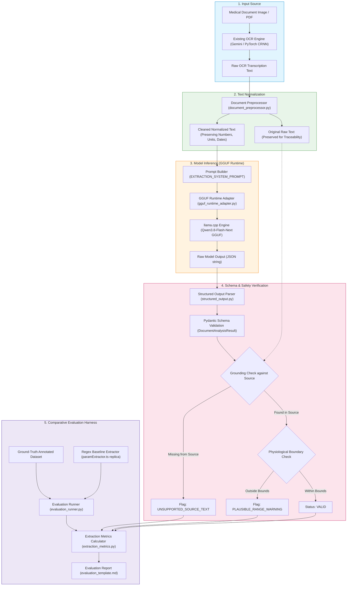

# 🏛️ Architecture & System Design: Open-Source LLM Integration

## 1. Executive Context

In MyHealthMitra, the active production pipeline relies on a two-tier cloud architecture:
1. **Multimodal OCR**: Google Gemini 3 Vision (`backend/src/services/ocr.ts`) transcribes document images/PDFs into text.
2. **Clinical Extraction**: A fast, deterministic regex parser (`backend/src/services/paramExtractor.ts`) extracts 10 core biomarkers.
3. **Categorization**: A weighted heuristic engine (`backend/src/services/categorizer.ts`) classifies documents into 6 clinical categories.

This experimental module (`llm_integration_prototype/`) investigates how a locally hosted, quantized open-source Large Language Model (specifically **Qwen3.8-Flash-Next GGUF**) can be evaluated as an alternative or augmentation for complex, unstructured medical text interpretation.

---

## 2. Experimental Data Flow & System Diagram

---

## 3. Production vs. Prototype Isolation

To protect the integrity of MyHealthMitra's production application:
- **Zero Production Changes**: No files in `backend/`, `flutter_app/`, `frontend/`, `ocr/`, or `prisma/` are modified or replaced.
- **No Shared Network Port**: The experimental prototype runs as an offline Python evaluation framework.
- **No Live Ingestion**: The prototype does not receive live patient uploads or write to the Supabase PostgreSQL database.
- **Explicit Fallback Protocol**: If model weights or the `llama-cpp-python` runtime are not installed, the prototype fails fast with informative configuration errors, never emitting simulated or fabricated outputs.
