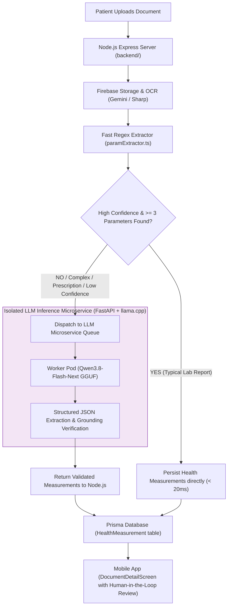

# 🚀 Production Integration Plan (Future Architecture Roadmap)

> **Notice**: This document outlines a potential future production architecture if evaluation confirms that the open-source LLM out-performs or productively complements the regex extractor.  
> **Current Status**: **ISOLATED PROTOTYPE ONLY**. Not implemented or connected to the live application.

---

## 1. Proposed Service Topology: Hybrid Cascade Model

Rather than blindly replacing the fast regex parser, the recommended production pattern is a **Hybrid Cascade Strategy**:



---

## 2. Advantages of the Hybrid Cascade Strategy

1. **Extreme Throughput & Low Cost**:
   - 70–80% of standard printed CBC and lipid profile reports are parsed instantly by regex in under 15ms with zero GPU/LLM compute overhead.
2. **Escalation for Ambiguity**:
   - Complex discharge summaries, multi-column tables, and handwritten prescriptions are escalated to the Qwen LLM for deep reasoning.
3. **Privacy & Data Sovereignty**:
   - Running Qwen locally on dedicated on-premise hardware or HIPAA-compliant VPC nodes ensures sensitive Protected Health Information (PHI) never leaves the data boundary.

---

## 3. Microservice Interface Specification (Proposed)

If deployed, the Python microservice would expose an internal REST API endpoint consumed exclusively by `backend/src/services/`:

### Endpoint: `POST /internal/v1/extract`
**Request Body**:
```json
{
  "document_id": "35f62e1d-07e1-41d6-813c-1857488563e3",
  "ocr_text": "Complete Blood Count\nHemoglobin: 13.8 g/dL...",
  "suggested_category": "Blood Test"
}
```

**Response Body**:
```json
{
  "success": true,
  "result": {
    "document_category": "Blood Test",
    "parameters": [
      {
        "parameter_key": "hemoglobin",
        "display_name": "Hemoglobin",
        "value": 13.8,
        "unit": "g/dL",
        "supporting_source_text": "Hemoglobin: 13.8 g/dL",
        "validation_status": "VALID"
      }
    ]
  },
  "latency_ms": 1420.5
}
```

---

## 4. Hardware Sizing & Provisioning Guide

| Deployment Tier | Model Quantization | Target Hardware | Expected Latency | Concurrency |
|---|---|---|---|---|
| **Tier 1: Minimal Edge / Local** | `IQ2_XS` (~10 GB) | Apple Mac Mini (16GB M2/M3) or CPU server | 2.5 – 4.0s per doc | 1 worker |
| **Tier 2: Workstation / Departmental** | `IQ3_S` (~16 GB) | Apple Studio (32GB M2/M3 Max) or 1x RTX 4090 (24GB VRAM) | 1.0 – 1.8s per doc | 2–4 workers |
| **Tier 3: Enterprise Cloud** | `IQ3_S` / BF16 | Kubernetes cluster with 1x NVIDIA A10G / L4 (24GB VRAM) | 0.8 – 1.5s per doc | Autoscaling |

---

## 5. Human-in-the-Loop Governance

In healthcare AI, automated extraction must never be treated as infallible truth:
1. Every measurement in MyHealthMitra stores its `supporting_source_text` in the PostgreSQL database.
2. `DocumentDetailScreen.dart` in Flutter displays an interactive card for each extracted biomarker.
3. Patients and clinicians can tap any parameter to view the exact line in the original document, edit numeric values, adjust units, or delete false positives.
4. If a parameter is manually corrected, the database sets `isManualEntry = true` for auditing.
